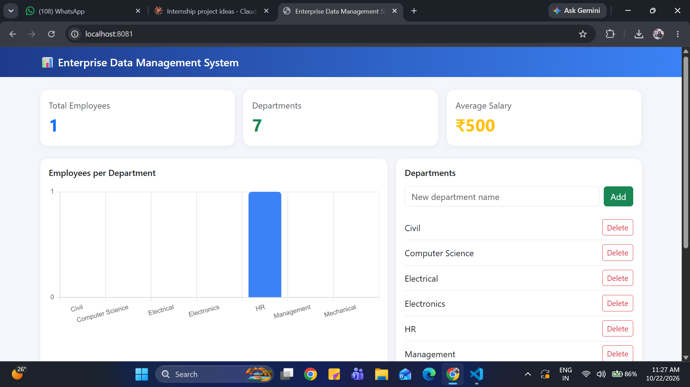

# DataDesk

A full-stack employee and department data management system built with plain Java, SQLite, and a Bootstrap dashboard.


Personal project inspired by my internship on an Enterprise Data Management System at Sayansi Pvt Ltd.

## Features
- Manage records: add, edit, and delete employees and departments (each employee belongs to a department)
- Dashboard: total employees, departments, average salary, and a chart of employees per department
- Search and export: search by name, filter by department, and download the list as CSV
- Role-based bonus: bonus is calculated differently for Managers, Developers, and Interns

## Tech Stack
- Backend: Java with the built-in `com.sun.net.httpserver` REST API
- Database: SQLite via JDBC (two related tables)
- Frontend: HTML, CSS, JavaScript, Bootstrap, Chart.js

## OOP Concepts Used
- Abstraction: abstract `Person` and `Employee` classes
- Inheritance: `Person` → `Employee` → `Manager` / `Developer` / `Intern`
- Polymorphism: each role overrides `getBonusRate()`, so `calculateBonus()` differs per role
- Interface: `Jsonable`, implemented by `Employee` and `Department`
- Encapsulation: private fields with getters
- Factory pattern: `EmployeeFactory` creates the right subclass from the stored role

## Project Structure
​```
src/   Java backend
web/   Frontend (index.html)
lib/   SQLite JDBC driver
​```

## How to Run
1. Install JDK 17 or newer and VS Code with the Extension Pack for Java.
2. Clone this repository and open the folder in VS Code.
3. Open `src/App.java` and click Run.
4. Open http://localhost:8081 in your browser.

The database file (`edms.db`) is created automatically on first run.

## Author
Arpita Jain | B.Tech CSE, United Institute of Technology, Prayagraj
